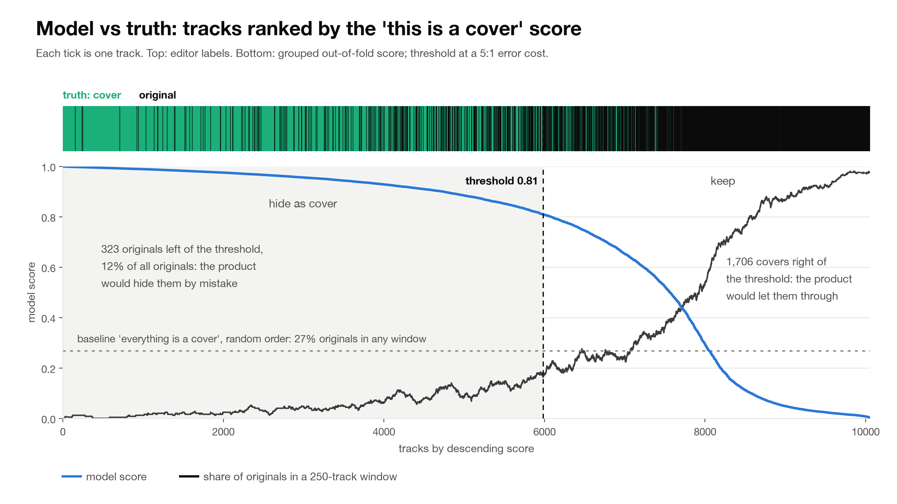
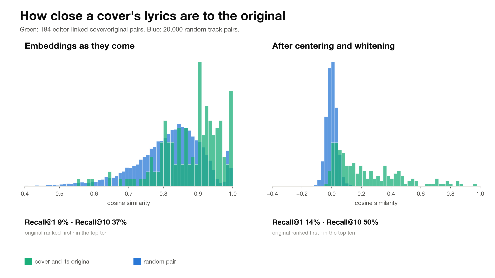

# music_covers

Telling cover songs from originals in a streaming catalogue, using lyric embeddings and
catalogue metadata. The data comes from a 2023 hackathon with a music streaming service:
about 80 thousand tracks labelled by the service's editors, lyrics for 10 thousand of them.
The dataset is not redistributable, so it is not in this repository; the schema is described
below and every number here can be reproduced with one command once the file is in place.

## Results

CatBoost (300 iterations, depth 6, balanced class weights) on 10,056 labelled tracks with
lyrics, 73% of them covers. Validation is 5-fold stratified cross-validation grouped by
song: a cover and its original always land in the same fold.

| Features | ROC-AUC | PR-AUC |
|---|---|---|
| catalogue date only | 0.739 | 0.875 |
| duration only | 0.703 | 0.859 |
| date, duration, language | 0.862 | 0.936 |
| lyric embeddings only | 0.876 | 0.940 |
| lyric embeddings, whitened | 0.869 | 0.933 |
| embeddings, date, duration | 0.910 | 0.958 |
| everything | **0.914** [0.908, 0.921] | **0.962** |

The interval is a 95% bootstrap over songs. A random (ungrouped) split on the same features
gives 0.914 against 0.910 grouped, so leakage through shared lyrics is small in this sample: the original of most
covers is simply not in the table.

Two things the table says. Half of the signal is in the metadata: covers enter the catalogue
later than originals and run about 40 seconds longer (median 208 s against 169 s). Lyrics add
five hundredths on top. And the lyric embeddings in the hackathon file are weak for finding a
cover's original: nearest-neighbour search over them ranks the original first for 9% of the
184 editor-linked pairs, 14% after centering and whitening. In four out of five of those pairs
the cosine between cover and original is below 0.95, which is what translations and rewritten
lyrics look like to a monolingual encoder.

**Threshold.** Hiding an original by mistake is worse than letting a cover through. Counting
that mistake as five times more expensive, the cost-optimal threshold is 0.81: the model
catches 77% of covers at 95% precision and wrongly hides 323 of 2,691 originals (12%).
Demanding 90% of covers raises that to 638 (24%). Against the "everything is a cover"
baseline at the same 77% coverage, a random selection would hide 77% of originals.
The cost curve is flat around the optimum, so the threshold moves by a few hundredths
between runs while the counts stay within a few dozen tracks.





## Data

`data/hackathon.csv`, one row per track:

| column | meaning |
|---|---|
| `track_id` | catalogue id |
| `original_track_id` | the original's id when the editors recorded it, `Noo` otherwise; originals point to themselves |
| `track_remake_type` | `ORIGINAL` or `COVER` |
| `dttm` | when the track entered the catalogue, Unix milliseconds (not the release date) |
| `language` | ISO code or `Noo` |
| `duration` | milliseconds |
| `target` | 1 for cover |
| `0` ... `767` | lyric embedding |

Only 4% of covers carry a link to their original, and the catalogue date is an upload date:
a 1969 song can be dated 2009. Both facts matter for anything that wants to find the original
of a cover rather than classify tracks, and both are why that part stays open.

The raw catalogue format (three JSON-lines files with lyrics, metadata and labels) is handled by
`coversml.data`, with a synthetic generator in `coversml.synth` so the pipeline can be exercised
without the real files.

## Reproduce

```
uv venv && uv pip install -e ".[dev]"
python -m pytest
python scripts/run_experiments.py data/hackathon.csv results/
python scripts/plots/ranking.py data/hackathon.csv results/ docs/ranking.png
python scripts/plots/similarity.py results/ docs/similarity.png
```

`run_experiments.py` writes the split comparison, the ablation, the full report with
intervals, thresholds, calibration and feature importance, and the retrieval numbers into
`results/`. The run takes about seven minutes on a laptop.

## Layout

```
src/coversml/
  data.py          raw catalogue loader, text normalisation, song groups by union-find
  hackathon.py     the hackathon table: embeddings, metadata, song groups
  split.py         grouped folds and the leak check the tests run
  eval.py          metrics with group bootstrap, cost threshold, calibration
  experiments.py   split comparison, ablation, final report, retrieval
  synth.py         synthetic catalogue in the raw format
scripts/           run_experiments.py and the plots
tests/             grouping, leak check, metrics, synthetic round trip
results/           JSON output of the last run
docs/              figures
```

## What is not done

Linking each cover to its original. The hackathon asked for it, and the right tool is a
multilingual sentence encoder over the lyrics themselves, which the embeddings in the file
cannot replace. Instrumental covers are out of reach for any text method.

## License

MIT for the code. The data belongs to the streaming service and is not covered.
